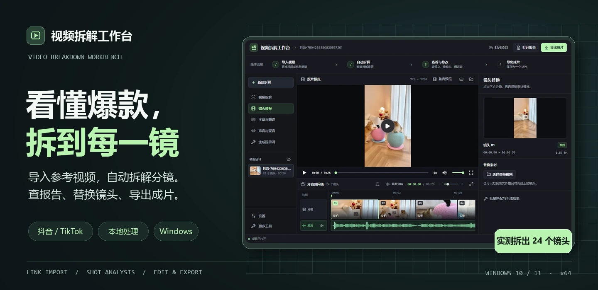
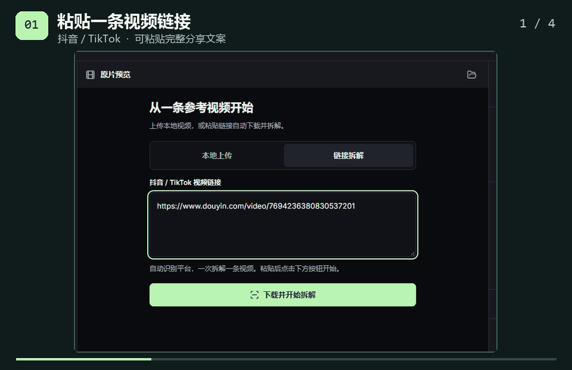
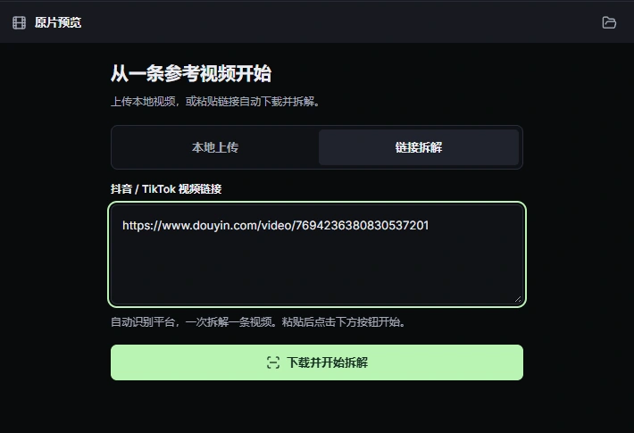
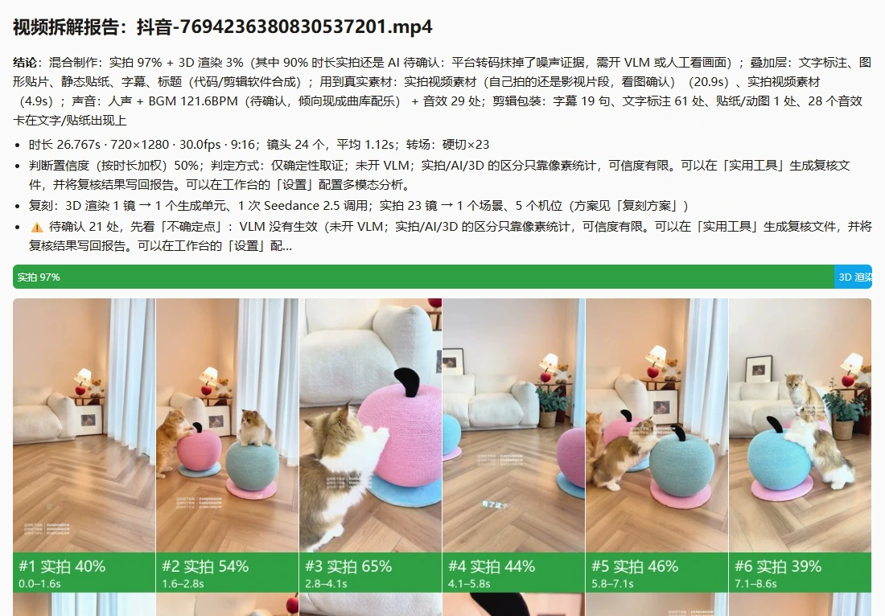
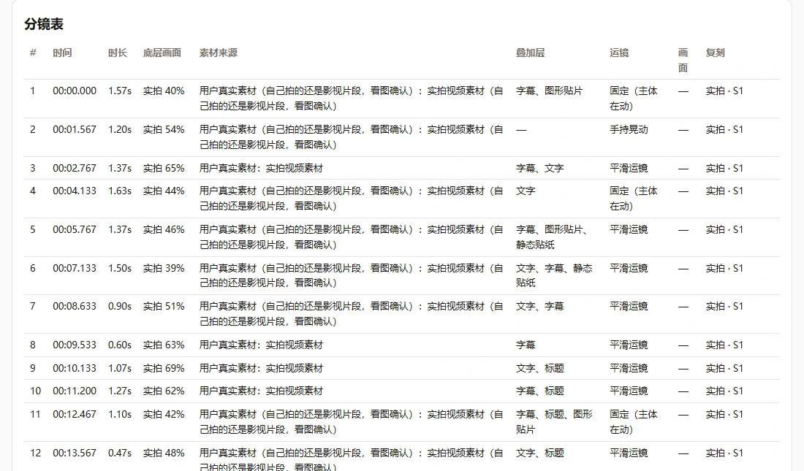
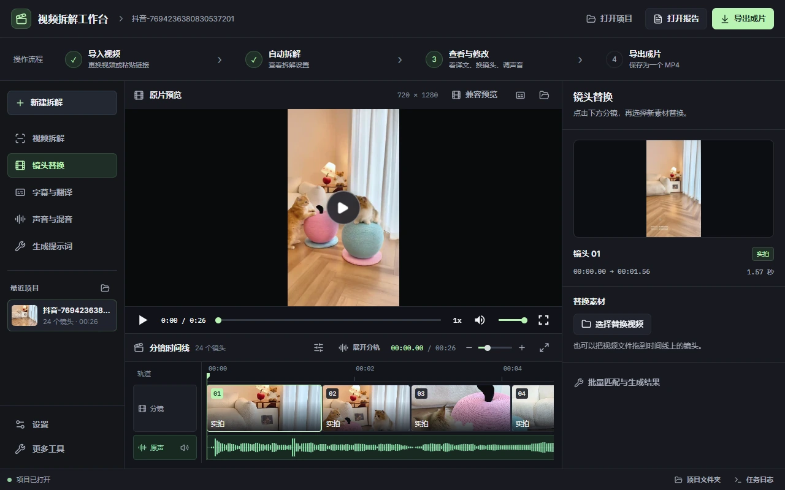

# 视频拆解工作台

把抖音、TikTok 参考视频拆成可查看、可替换的镜头。在 Windows 上完成分镜分析、字幕校对、音轨混音和成片导出。

**[下载 Windows 便携版（1.92 GB）](https://github.com/lashawnaplikerd710-del/video-breakdown-workbench/releases/download/v0.1.0/Video-Breakdown-Workbench-v0.1.0-Windows-x64.zip)** · [查看版本详情](https://github.com/lashawnaplikerd710-del/video-breakdown-workbench/releases/tag/v0.1.0) · [从源码运行](docs/BUILD.md)

## 从参考视频到可编辑分镜

演示省略了下载和分析的等待时间。

### 1. 导入视频

在「新建拆解」里选择 **本地上传** 或 **链接拆解**。粘贴抖音或 TikTok 的公开视频链接或整段分享文字，点击「下载并开始拆解」，工作台会在下载完成后自动分析。

### 2. 看懂视频怎么做

完成后可在时间线点选镜头，也可以点「打开报告」，从整条视频的结构一路查到单个镜头。图中展示的是一个 26 秒抖音样片，实测拆出了 **24 个镜头**。

| 报告内容 | 能看到什么 |
| --- | --- |
| 内容与结构 | 开场、内容推进、结尾，以及各段落的作用 |
| 画面与制作 | 角色、场景、道具、机位、打光和剪辑方式 |
| 字幕与声音 | 画面文字、双语对应、声音分析和音效卡点 |
| 分镜表与复刻方案 | 镜头起止时间、画面描述、制作方式和可参考的素材清单 |

展开查看逐镜分镜表

### 3. 换成自己的素材

在时间线上选中镜头，添加替换视频。也可逐句校对字幕、调整原声和配乐音量、复制镜头提示词，再导出 MP4。

## 安装和使用

适用于 **Windows 10 / 11 64 位**。下载 ZIP 并全部解压，打开「视频拆解工作台」文件夹，双击 **启动视频拆解工作台.exe**。如果提示缺少运行组件，可按启动界面提示安装包内组件。

链接下载需要网络，平台和地区会影响可用性。视频拆解、报告和剪辑支持本机运行。多模态分析和自动生成需要在软件设置中接入自己的服务。自动识别结果可以在工作台内校对。

## 许可证

工作台源码采用 [Apache License 2.0](LICENSE)。分析引擎基于 [JuneYaooo/rea-video](https://github.com/JuneYaooo/rea-video/tree/89e27e00ec6749da7ee2b23e76e0f90c604688d1)。依赖、字体和图标保留原有许可证，见 [NOTICE](NOTICE)、[第三方组件说明](THIRD_PARTY_NOTICES.txt) 及各组件目录。
